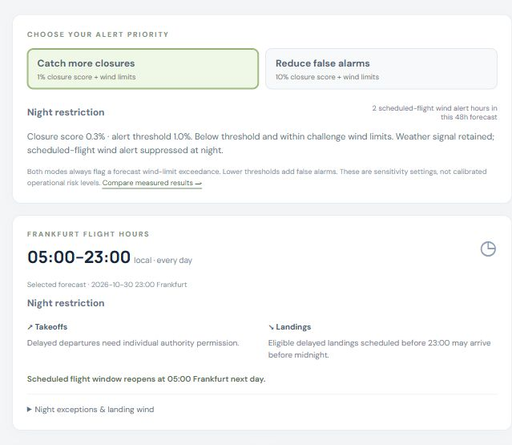

# AIW-AIRWAYS — FRA WindLab

A responsive Frankfurt Airport forecasting dashboard, built for the FraAlliance AI Week 2026 challenge. It includes a real trained probability model, 48-hour weather forecasts, a runway schematic, hourly wind and probability charts, a challenge-rule sandbox, CSV export, validation results, source provenance, and a printable model card.

**Research prototype:** targets are derived from observed weather using the challenge rules. Historical operating-direction and RWY 18 availability records were not obtained. Reported scores therefore do not establish accuracy against actual operations.

## Use locally

No JavaScript dependencies or build step are required. From this folder:

```powershell
python -m http.server 8788 --bind 127.0.0.1 --directory dist
```

Open `http://127.0.0.1:8788`. The initial page uses the included, timestamped real-weather snapshot. Refresh calls the public Open-Meteo DWD ICON endpoint. If a request fails, the existing snapshot remains visible with a failure message. The page needs HTTP serving because it uses JavaScript modules and JSON fetches.

The existing [hosted dashboard](https://frankfurt-wind-lab-thiag.statworx-par-2884.chatgpt.site) has its own access controls. This repository can be run locally without a hosting account. Personal hosting configuration and credentials are excluded.

## Reproduce training and historical forecasts

Python 3.11+, NumPy, pandas and Node.js 20+ are sufficient:

```powershell
python -m pip install -r requirements.txt
python model/download_data.py
python model/train.py
python model/evaluate_alerts.py
node model/build_snapshot.mjs
python model/predict.py --issue-time 2026-05-10T06:00:00Z --hours 48 --output model/prediction.csv
python scripts/make_model_card.py
node tests/run.mjs
node model/check_inference.mjs
```

See [model/README.md](model/README.md) for chronology, features, labels, baselines, replay constraints and the ground-truth data schema. Raw public-weather downloads are included in `model/raw/`, with request URLs in `model/raw/manifest.json`; the downloader uses cached files. The saved model, metrics and forecasts are included in `dist/data/`. Historical export currently supports the downloaded 2026 holdout period after model selection. Jury dates have not yet been supplied. Do not report the example replay as a submitted jury forecast.

## Results and limits

- Training sources contain 49,600 EDDF METAR reports from January 2024 through October 2026, plus archived DWD ICON forecast data.
- Frozen train/validation/test splits are chronological with 72-hour gaps. Only past observations and forecast archives predating each origin are used as input.
- Direction-proxy classification beats the deterministic weather-rule baseline at 1h and 6h, but loses at 24h and 48h. Full probability and class metrics appear in `dist/data/metrics.json`.
- RWY 18 closure detection is weak: zero of five test closure-proxy hours detected at a 0.5 threshold. The dashboard displays the independent wind-rule limit calculation. High open-class accuracy is not evidence of useful closure detection.
- Live forecasts use fresher numerical-weather inputs than the fixed-lead historical evaluation. Reported test scores are not proof of live accuracy or operational calibration.
- Current METAR and operating-direction observations are saved snapshots. Browser weather refresh updates only ICON. After 90 minutes, origin weather falls back explicitly to modeled current conditions; current direction is inferred from wind unless a recent verified snapshot exists. The operations source date is never silently refreshed.
- Forecasts are hourly. The next shift is the first hourly probability crossing, not a prediction with minute-level precision. Nearest-horizon models are used between measured leads.

## Alert priorities and Frankfurt flight hours

The overview supports **Catch more closures** (closure score ≥1%) and **Reduce false alarms** (≥10%). Both alert whenever forecast tailwind or gust crosswind exceeds the challenge limits. The trained probabilities are unchanged. Thresholds are fixed sensitivity choices, not calibrated costs or tuned optima. The comparison reuses the existing test set whose original scores were already known; it is not a fresh untouched test.

| Lead | Catch: detected / positive hours | Catch: false alarms | Reduce: detected / positive hours | Reduce: false alarms |
|---|---:|---:|---:|---:|
| 1h | 3/3 | 116 | 0/3 | 4 |
| 6h | 2/3 | 113 | 0/3 | 1 |
| 24h | 1/3 | 73 | 0/3 | 0 |
| 48h | 0/3 | 86 | 0/3 | 0 |

These counts cover scheduled hours only; three weather-proxy positive hours do not establish operational reliability. Validation has only 0–1 positives and detection remains weak. The dashboard exposes both all-hour and scheduled-hour counts, precision, misses, and validation support. Complete results and definitions are in `dist/data/alert-policies.json`; reproduce with `python model/evaluate_alerts.py` without retraining.

The separate flight clock uses **Europe/Berlin**, including daylight saving time: scheduled takeoffs and landings 05:00 inclusive to 23:00 exclusive. The 23:00–05:00 night restriction suppresses scheduled-flight alerts but never changes weather probabilities or counts as a detected wind closure. Between 23:00 and midnight, eligible delayed landings may arrive; delayed takeoffs need individual authority permission. From midnight to 05:00, ordinary delayed/early flights are not admitted. Statutory exemptions remain possible. Shoulder-hour restrictions are described without inventing slot availability or flight permission.

Sources: [Fraport operating hours](https://www.fraport.com/en/sustainability/dialog-with-neighbors/noise-and-air/flight-operations/runway-system-and-operating-hours.html) and [Hessen delayed-flight rules](https://wirtschaft.hessen.de/Verkehr/Luftverkehr/Verspaetete-Starts-und-Landungen), checked 30 October 2026. Both the browser CSV and historical CLI export both priorities and the flight-hour layer.

## Sources and assumptions

Historical observations: [Iowa Environmental Mesonet](https://mesonet.agron.iastate.edu/request/download.phtml). Numerical forecasts: [DWD ICON through Open-Meteo](https://open-meteo.com/en/docs/dwd-api) and [Previous Runs](https://open-meteo.com/en/docs/previous-runs-api). Current observation snapshot: [NOAA Aviation Weather Center](https://aviationweather.gov/data/api/). Direction context: [Umwelthaus, citing DFS](https://www.umwelthaus.org/fluglaerm/anwendungen-service/aktuelle-betriebsrichtung-und-prognose/). Weather attribution belongs to the original providers; Open-Meteo data are provided under its published terms and attribution requirements.

The supplied case PDF specifies 15 kt RWY 18 tailwind, 40 kt gust crosswind, a 10 kt immediate direction-change threshold, and persistence beyond 30 minutes. [Fraport's public guidance](https://www.fraport.com/en/business-areas/operations/airside-and-terminal-operations/easterly-and-westerly-operations.html) describes a different 5 kt landing tailwind threshold. The dashboard follows the challenge and does not represent airport operating standards.

The supplied 6m29s audio was transcribed locally. Its requirements support the two targets and 48-hour horizon; exact numeric rules come from the PDF. The recording and supplied PDF are in `references/`; transcript artifacts and review notes are in `research/`. The optional local transcription script uses `requirements-audio.txt`. These source materials are evidence, not instructions to execute.

## Checks performed

Tests cover threshold boundaries, cardinal wind directions, small-tailwind persistence, missing wind, forecast continuity, probability normalization, Python/browser coefficient parity, and evaluation-count integrity. Browser checks cover weather refresh, horizon selection, time zones, scenario controls, navigation, and a verified 48-row CSV export. Desktop and narrow layouts were reviewed.

## Project layout

- `dist/`: the complete static dashboard and trained model assets.
- `model/`: data downloader, training, inference checks and historical replay CLI.
- `tests/`: core behavior checks.
- `scripts/`: generated model-card helper.
- `references/`: the user-supplied challenge PDF and audio recording.
- `research/`: local audio transcript, review notes, and optional transcription script.
- `docs/images/`: dashboard previews.
- `PROJECT_MANIFEST.json`: relative file paths, byte counts and SHA-256 hashes for the imported project after portable line-ending normalization.

## Repository handoff

This import preserves the repository's initial commit and adds the complete working project as of 30 October 2026. The application source comes from Site commit `590ff63862fa9a1d93786d0fc8d6934ef18587f1`; public raw data and briefing materials are included for reproducibility. Dependencies, model-download caches, temporary files, private hosting bindings and authentication data are excluded.

The dashboard works from the included snapshot without Python ML packages. Training and historical replay require the Python requirements above. Local transcription additionally requires `python -m pip install -r requirements-audio.txt`; it downloads the selected Whisper model on first use. Run `python research/transcribe_audio.py base` from the repository root if a new transcript is needed.

Source-provider attribution is retained in the dashboard and documentation. Third-party weather data and briefing materials remain subject to their original terms. Actual runway-operation history and jury test dates have not yet been supplied.


